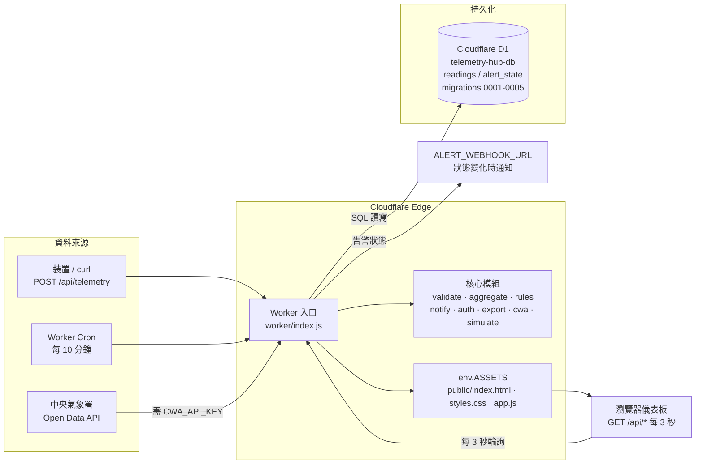

# TELEMETRY HUB · 遙測資料監控系統（期末專案）

TELEMETRY HUB 是一套部署在 **Cloudflare Workers** 上的輕量級遙測平台：接收裝置（溫度、濕度、電壓、訊號強度等）回傳的量測資料，寫入 **Cloudflare D1**，即時統計、判斷警戒條件，並在瀏覽器儀表板中視覺化。

整套系統沒有獨立的後端伺服器：Worker 同時處理 API 與靜態頁面；前端是純 HTML / CSS / JavaScript，不用 React、不用打包工具。

## 線上網址

**https://telemetry-hub.fieldnotebook.workers.dev**

健康檢查：https://telemetry-hub.fieldnotebook.workers.dev/api/health

---

## 核心能力

- **資料接收**：`POST /api/telemetry` 接收單筆或批次量測，驗證欄位型別與範圍。
- **持久化**：資料寫入 D1（SQLite）的 `readings` 資料表，不受 Worker 重啟影響。
- **即時統計**：依 `device + metric` 計算最新值、最小值、最大值、平均值與樣本數。
- **告警規則**：以 Threshold 規則判斷異常，在告警控制台顯示裝置、數值與時間。
- **視覺化儀表板**：波形控制列用「縣市＋測站」兩層連動下拉與五個精簡指標按鈕（全部四線、temperature、humidity、voltage、rssi）切換；波形右上角可用「過去 24 小時／未來 3 天／全部歷史」快速過濾，Canvas 可畫雙 Y 軸或四線同圖。
- **單一測站優先**：進入頁面或切換縣市時，自動選定該縣市的第一個測站（優先排列具備完整四項指標者），避免不同設備的數值混在同一條線上；仍可手動改選「全部測站」。
- **表格操作**：裝置狀態表支援關鍵字搜尋、縣市篩選、每頁 10 筆分頁；「範圍」欄以 Bullet Gauge 顯示固定物理量程、歷史波動區間與最新值圓點；點擊列會連動波形並捲動定位。
- **真實氣象資料**：「載入氣象資料」預設抓取中央氣象署 `F-D0047-089`（全台灣／指定縣市未來 3 天逐 3 小時預報），解析溫度 `T` 與相對濕度 `RH` 的多個預報時間點，device 以 `cwa-fx-<Geocode>` 表示；定時 Cron 仍使用即時觀測 `O-A0001-001`（`cwa-<測站編號>`）。硬體上傳流程完全不變。
- **定時更新**：Worker Cron 每 10 分鐘自動抓取氣象署觀測，同時以同一台 `sensor-a2` 寫入溫度／濕度／電壓／訊號四項模擬讀數（每分鐘取樣，每次 6 個時間點 × 4 指標 = 24 筆）。
- **地區欄位**：每筆量測可選填 `region`，會顯示在裝置表、事件流與 CSV 匯出中；波形控制列與表格篩選器可選「全部縣市」或 22 個台灣縣市。
- **去重複**：同一 `device + metric + 觀測時間` 只保留一筆，定時抓取不會重複塞入同一小時的資料。
- **寫入保護**：設定 `API_TOKEN` 後，寫入端點需帶 `Authorization: Bearer <token>`；讀取端點維持公開。
- **告警通知**：狀態變化時可 POST 到 `ALERT_WEBHOOK_URL`，通知狀態存在 D1，避免重複發送。
- **SQL 聚合**：統計與告警由 D1 直接分組計算，不再受限於最近 500 筆。
- **資料匯出**：`GET /api/export` 可下載 CSV，儀表板也提供「匯出 CSV」按鈕。
- **主題切換**：深色 / 淺色主題可切換，選擇會保存在瀏覽器。
- **可測試**：驗證、統計、告警等核心邏輯為純函式，可用 `node --test` 在本機測試。

---

## 系統架構



資料流：

1. 裝置送出量測到 `POST /api/telemetry`；Worker 驗證欄位、補上 `received_at` 後寫入 D1。
2. 瀏覽器每 3 秒呼叫 `GET /api/summary`，一次取得統計、告警、規則、最近 60 筆與總數；同時呼叫 `GET /api/readings?limit=400`（可加 `device`、`region`）取得目前測站/地區自己的序列，避免低頻 CWA 測站被全域最近 60 筆擠出波形。波形右上角可再依「過去 24 小時／未來 3 天／全部歷史」過濾。
3. `src/rules.js` 比對最新值與 Threshold；異常項目顯示在告警控制台。
4. 告警狀態由 `src/notify.js` 寫回 `alert_state`；狀態改變時才發出 Webhook。
5. Worker Cron 每 10 分鐘呼叫 `scheduled()`，先以同一台 `sensor-a2` 寫入四項模擬讀數，再以 `mode=observation` 匯入氣象署即時觀測；手動「載入氣象資料」則用 `mode=forecast`（預設）一次寫入未來 3 天序列。即使沒設定 `CWA_API_KEY`，四條模擬波形仍會持續累積。

---

## 資料格式

單筆上傳：

```json
{
  "device": "sensor-a1",
  "region": "溫室 A",
  "metric": "temperature",
  "value": 26.7,
  "unit": "C",
  "timestamp": "2026-11-20T09:30:00Z"
}
```

批次上傳：

```json
{
  "readings": [
    { "device": "sensor-a1", "region": "溫室 A", "metric": "temperature", "value": 26.7, "unit": "C" },
    { "device": "sensor-a1", "region": "溫室 A", "metric": "humidity", "value": 61.2, "unit": "%" }
  ]
}
```

| 欄位 | 型別 | 必填 | 說明 |
| --- | --- | --- | --- |
| `device` | string | 是 | 裝置 ID，例如 `sensor-a1` |
| `region` | string | 否 | 量測地區／測站所在地，例如 `溫室 A`、`臺北`，最長 64 字 |
| `metric` | string | 是 | 指標名稱：`temperature`、`humidity`、`voltage`、`signal` |
| `value` | number | 是 | 有限數值或數字字串，不接受 `NaN` / `Infinity` / `null` |
| `unit` | string | 否 | 單位：`C`、`%`、`V`、`dBm` |
| `timestamp` | ISO 8601 string | 否 | 量測時間；省略時由 Worker 補上 |

---

## API 規格

| 方法 | 路徑 | 說明 |
| --- | --- | --- |
| `GET` | `/api/health` | 健康檢查，回傳 `{"ok":true,"service":"telemetry-hub"}` |
| `POST` | `/api/telemetry` | 上傳單筆或批次量測 |
| `POST` | `/api/import/cwa` | 拉取 `F-D0047-089` 未來 3 天逐 3 小時 T/RH 預報並寫入（需 `CWA_API_KEY`）；body 可傳 `{ "region": "高雄市", "mode": "forecast" }`，`mode: "observation"` 則回到即時觀測 |
| `POST` | `/api/simulate` | 測試用：寫入 24 筆 `sensor-a2` 模擬讀數（6 個時間點 × 溫度／濕度／電壓／訊號），可在 body 傳 `{ "region": "高雄市" }` |
| `GET` | `/api/readings?device=&metric=&region=&limit=100` | 查詢最近量測（最多 500 筆） |
| `GET` | `/api/stats?region=` | 各裝置 / 指標的統計摘要 |
| `GET` | `/api/alerts?region=` | 目前的告警列表 |
| `GET` | `/api/summary?region=` | 儀表板用：統計 + 告警 + 規則 + 最近 60 筆 + 總數 |
| `GET` | `/api/export?device=&metric=&region=&limit=5000` | 匯出 CSV（最多 10000 筆） |
| `DELETE` | `/api/readings` | 清空所有量測（展示用重置） |

設定 `API_TOKEN` 後，`POST /api/telemetry`、`POST /api/import/cwa`、`DELETE /api/readings` 需附帶 `Authorization: Bearer <token>`；所有 `GET` 端點仍可公開讀取。`POST /api/simulate` 是免 Token 的測試端點，供「注入模擬讀數」按鈕使用。

`/api/readings` 與 `/api/stats` 的每筆資料都包含 `region`（未填時為空字串）；`GET /api/export` 的 CSV 欄位順序為 `device,region,station,metric,value,unit,timestamp,receivedAt`。

上述 `GET` 端點都可用 `?region=金門縣` 依縣市過濾，KPI、統計、告警、波形與 CSV 都會只處理該地區的資料；未帶參數時才顯示全部。

成功回應：

```json
{ "ok": true, "accepted": 1, "total": 128 }
```

失敗回應：

```json
{ "ok": false, "error": "INVALID_PAYLOAD", "message": "value must be a finite number" }
```

```json
{ "ok": false, "error": "UNAUTHORIZED", "message": "missing or invalid API token" }
```

---

## 告警規則與通知

規則定義在 `src/rules.js`，可依需求增減：

| Rule ID | Device | Metric | 條件 |
| --- | --- | --- | --- |
| `temp-high` | `sensor-a1` | `temperature` | `value > 30` |
| `humid-high` | `sensor-a1` | `humidity` | `value > 70` |
| `volt-low` | `sensor-a2` | `voltage` | `value < 11.5` |
| `signal-low` | `sensor-a2` | `signal` | `value < -80` |

在 Worker 設定以下 Secret 即可啟用 Webhook；未設定時完全不發出通知：

| Secret | 說明 |
| --- | --- |
| `ALERT_WEBHOOK_URL` | 接收通知的 URL，會收到 `POST` JSON |
| `ALERT_WEBHOOK_TOKEN` | 選填，通知請求的 Bearer Token |
| `ALERT_WEBHOOK_RESOLVE` | 設為 `1` 時，告警解除也發出通知 |

通知內容包含 `type`（`triggered` / `resolved`）、`rule`、`device`、`metric`、`value`、`threshold` 與 `timestamp`。狀態存放在 `alert_state` 資料表，因此同一條規則只會在狀態改變時通知一次。

---

## 匯入中央氣象署真實資料（報告用）

這條路徑使用中央氣象署的**官方 Open Data API**，不是網頁爬蟲；取的資料集是 `O-A0001-001`（自動氣象站觀測資料）。它只是另一種資料來源，原本給硬體用的 `POST /api/telemetry` 完全沒有改變。

### 1. 申請 API 授權碼

1. 到 https://opendata.cwa.gov.tw 註冊／登入會員。
2. 在會員中心申請「API 授權碼」，取得的字串通常長得像 `CWA-xxxxxxxx-xxxx-xxxx-xxxx-xxxxxxxxxxxx`。
3. 授權碼是免費的；API 文件可見 https://opendata.cwa.gov.tw/dist/opendata-swagger.html 。

### 2. 設定授權碼

上傳到 Worker：

```powershell
npx wrangler secret put CWA_API_KEY
```

本機腳本可寫在 `11/.dev.vars`（此檔已在 `.gitignore`）：

```dotenv
CWA_API_KEY=CWA-你的授權碼
```

`.dev.vars` 不會隨 `public/` 一起上傳；雲端 Cron 只讀取 Wrangler Secret。

### 3. 載入資料

- **最簡單**：先在波形監測控制列選擇台灣縣市，再點「資料入口」區塊的「載入氣象資料」，會呼叫 `POST /api/import/cwa`（`mode=forecast`）抓取 `F-D0047-089`，把該縣市未來 3 天的溫度與濕度（每 3 小時一點、約 24～32 個時間點）一次寫入 D1；畫面會自動切到「未來 3 天」並選定第一個 `cwa-fx-` 測站，不用等 Cron 慢慢累積。未選縣市時會抓全台灣，但受限於單次 6000 筆上限，建議先選縣市。
- **波形時間範圍**：波形右上角三個按鈕只過濾 Canvas 的取點範圍（過去 24 小時／未來 3 天／全部歷史），指標統計與告警仍依全部資料計算，避免資料變多後圖表擠在一起。
- **自動累積波形**：部署後 Worker Cron 每 10 分鐘抓一次氣象署**即時觀測**（`mode=observation`），並同時為同一台 `sensor-a2` 寫入 6 組模擬讀數，每組都含溫度（C）、濕度（%）、電壓（V）、訊號（dBm）四個欄位；同一測站、同一指標、同一時間的重複資料會被 D1 唯一索引忽略。本機 `.dev.vars` 可設 `CWA_REGIONS=金門縣,臺北市` 限制定時抓取範圍，未設定時抓全部測站，模擬讀數也會跟著寫入相同 `region`。
- **上游容錯**：氣象署 API 單次請求逾時（15 秒）或回 5xx 時會自動重試一次，失敗訊息會直接顯示在頁面上。
- **手動測試四線**：點「資料入口」的「注入模擬讀數」會呼叫 `POST /api/simulate` 立刻寫入 24 筆（6 個時間點 × 四項指標），波形區選「全部四線」即可看到同一台 `sensor-a2` 的溫度、濕度、電壓、訊號四條線（各自獨立量程，圖例顯示最新值與單位）；不需要再混用不同設備的資料。
- **只看所選縣市**：切換波形控制列的縣市下拉時，儀表板會呼叫 `/api/summary?region=<縣市>`，KPI、波形、告警、事件流與裝置表都只顯示該縣市；「匯出 CSV」也只匯出該縣市。
- **範圍刻度條**：「範圍」欄改用固定物理量程的 Bullet Gauge（溫度 0–40°C、濕度 0–100%、電壓 3.0–4.2V、訊號 -110–-40dBm）。暗色底軌上以高亮條標出歷史 min–max 波動區間（`min = max` 時不畫），圓點標記最新值位置；溫度依 18/28°C 切換冷藍／青綠／暖橘紅，其他指標依距離告警門檻遠近切換綠／黃／紅。
- **命令列**：`npm run import:cwa`，可加 `--clear` 先清空舊的假資料：

```powershell
npm run import:cwa -- --clear
```

若 Cron 的即時觀測只要特定測站，可設 `CWA_STATIONS=466920,466990`（逗號分隔的測站編號）；此限制只在未指定縣市時生效，不影響手動預報匯入。

API 也可直接指定縣市與模式：

```json
{ "region": "高雄市", "mode": "forecast" }
```

```json
{ "region": "金門縣", "mode": "observation" }
```

### 4. 資料對照

| CWA 欄位 | Telemetry HUB 欄位 |
| --- | --- |
| 觀測 `StationId` | `device = cwa-<測站編號>` |
| 觀測 `StationName` + `GeoInfo.TownName` | `station = 測站名稱（鄉鎮）`；`region = 測站所在地區`，若指定縣市則 `region = 所選縣市` |
| 觀測 `GeoInfo.CountyName` | 依所選縣市篩選測站 |
| 觀測 `WeatherElement.AirTemperature` | `metric = temperature`，單位 `C` |
| 觀測 `WeatherElement.RelativeHumidity` | `metric = humidity`，單位 `%` |
| 觀測 `ObsTime.DateTime` | `timestamp`（轉成 ISO 8601），裝置表「測量日期」與事件流日期取 UTC 當天 |
| 預報 `Geocode` | `device = cwa-fx-<Geocode>`，與即時觀測測站分開，不會互相覆蓋 |
| 預報 `LocationName` / `TownName` | `region = 縣市`；`station = 鄉鎮` 或 `縣市（鄉鎮）` |
| 預報 `WeatherElement.溫度` → `ElementValue.Temperature` | `metric = temperature`，單位 `C` |
| 預報 `WeatherElement.相對濕度` → `ElementValue.RelativeHumidity` | `metric = humidity`，單位 `%` |
| 預報 `Time.DataTime` / `StartTime` | `timestamp`；只取當地時間 00/03/06/.../21 的逐 3 小時點，轉成 ISO 8601 |

觀測舊格式中 `HUMD` 是 0–1.0 的小數，程式會自動乘以 100；`-99` 與 `X` 視為缺測並跳過。預報與觀測都以同一組唯一索引 `device + metric + ts` 去重，重複按「載入氣象資料」不會長出第二筆相同時間點；溫度與濕度可由 CWA 或 Cron 模擬補充，電壓與訊號則由 Cron 模擬產生。

---

## 檔案結構

```text
11/
├── wrangler.jsonc              Worker 名稱、assets、D1 binding、Cron
├── package.json                dev / deploy / db / test 指令
├── migrations/
│   ├── 0001_init.sql           建立 readings 資料表與索引
│   ├── 0002_alert_state.sql    建立告警通知狀態表
│   ├── 0003_reading_region.sql 增加 readings.region 欄位
│   ├── 0004_reading_station.sql 增加 readings.station 欄位（測站名稱）
│   └── 0005_reading_dedupe.sql  觀測時間唯一索引，避免定時抓取重複寫入
├── worker/
│   └── index.js                Worker 入口：路由 + 靜態資源
├── src/
│   ├── validate.js             欄位驗證與正規化
│   ├── stats.js                統計摘要（純函式）
│   ├── aggregate.js            D1 SQL 聚合與最新值
│   ├── rules.js                告警規則與判斷
│   ├── notify.js               Webhook 狀態機
│   ├── auth.js                 寫入端點 Token 檢查
│   ├── export.js               CSV 序列化
│   ├── cwa.js                  中央氣象署資料轉換
│   └── simulate.js             溫度／濕度／電壓／訊號模擬
├── public/
│   ├── index.html              儀表板頁面
│   ├── styles.css              版面、色彩、波形與動畫
│   └── app.js                  資料抓取、Canvas 圖表、互動
├── scripts/
│   ├── import-cwa.mjs          從中央氣象署匯入真實觀測資料
│   └── check-config.mjs        部署前檢查 D1 database_id
├── test/
│   ├── core.test.mjs           核心邏輯單元測試
│   └── worker.test.mjs         Worker 路由測試（mock D1）
└── README.md                   本文件
```

---

## 本機開發

需要 Node.js 20 以上。可共用先前專案已安裝的 wrangler，或在此目錄重新安裝：

```powershell
cd C:\Users\user\Desktop\_se\_se\11
npm install
npm run db:local
npm run dev
```

開啟 http://localhost:8787 。

`@cloudflare/vite-plugin` 不是必須；`wrangler dev` 會在本機 workerd 中執行 Worker，並用本機 SQLite 模擬 D1，因此 `/api` 是真的打到資料庫。

若要在本機測試 Token 或 Webhook，在專案根目錄建立 `.dev.vars`（已被 `.gitignore` 忽略）：

```text
API_TOKEN=local-secret
ALERT_WEBHOOK_URL=https://example.com/hook
```

其他指令：

```powershell
npm test             # 核心邏輯 + Worker 路由測試
npm run config:check # 檢查 D1 database_id 是否已完成設定
npm run check        # 測試 + 設定檢查
npm run cf:dry       # 部署前 dry-run
npm run deploy       # 檢查設定後部署到 Cloudflare
```

---

## 部署到 Cloudflare

### 目前部署狀態

- 網址：**https://telemetry-hub.fieldnotebook.workers.dev**
- Worker：`telemetry-hub`
- Cron：`*/10 * * * *`（每 10 分鐘）
- D1：`telemetry-hub-db`，migrations `0001`–`0005` 皆已套用
- Secret：`CWA_API_KEY` 已寫入雲端；`.dev.vars` 不會上傳

### 首次部署流程

1. 登入 Wrangler：

```powershell
npx wrangler login
```

2. 建立 D1 資料庫：

```powershell
npx wrangler d1 create telemetry-hub-db
```

3. 把指令印出的 `database_id` 填入 `wrangler.jsonc` 的 `d1_databases[0].database_id`（目前已是真實值，`npm run config:check` 會驗證）。

4. 依需求設定 Secret（未設定就不啟用該功能）：

```powershell
npx wrangler secret put API_TOKEN
npx wrangler secret put ALERT_WEBHOOK_URL
npx wrangler secret put ALERT_WEBHOOK_TOKEN
npx wrangler secret put ALERT_WEBHOOK_RESOLVE
npx wrangler secret put CWA_API_KEY
```

5. 套用遠端 migration 後部署（`npm run deploy` 會先自動執行 `config:check`）：

```powershell
npm run db:remote
npm run deploy
```

部署完成後 Wrangler 會印出 `*.workers.dev` 網址；本專案目前使用上方「線上網址」。

---

## 操作示範

以下直接以上線網址示範：

```bash
curl https://telemetry-hub.fieldnotebook.workers.dev/api/health

curl -X POST https://telemetry-hub.fieldnotebook.workers.dev/api/telemetry `
  -H "Content-Type: application/json" `
  -d '{"device":"sensor-a1","metric":"temperature","value":32.5,"unit":"C"}'

curl -X POST https://telemetry-hub.fieldnotebook.workers.dev/api/import/cwa
curl -X POST https://telemetry-hub.fieldnotebook.workers.dev/api/simulate
curl "https://telemetry-hub.fieldnotebook.workers.dev/api/readings?device=sensor-a1&limit=10"
curl https://telemetry-hub.fieldnotebook.workers.dev/api/summary
curl -o telemetry.csv "https://telemetry-hub.fieldnotebook.workers.dev/api/export?format=csv"
```

若有設定 `API_TOKEN`，寫入時改用：

```bash
curl -X POST https://telemetry-hub.fieldnotebook.workers.dev/api/telemetry `
  -H "Content-Type: application/json" `
  -H "Authorization: Bearer <token>" `
  -d '{"device":"sensor-a1","metric":"temperature","value":32.5,"unit":"C"}'
```

---

## 驗收檢查表

- [ ] `GET /api/health` 回傳 `ok: true`
- [ ] 上傳單筆與批次資料皆回傳 `accepted`
- [ ] 重新整理頁面後統計數值保留（D1 持久化）
- [ ] 注入高溫資料時，告警控制台出現 `temp-high`
- [ ] 1440 / 768 / 390 三種寬度沒有水平捲動
- [ ] 淺色 / 深色主題切換後，重新整理仍保留選擇
- [ ] 有設定 `API_TOKEN` 時，沒有 Token 的寫入要求回傳 401
- [ ] 同一條告警只觸發一次 Webhook，解除後再觸發可再次通知
- [ ] `GET /api/export` 下載的 CSV 內容與篩選條件相符
- [ ] 設定 `CWA_API_KEY` 後，`POST /api/import/cwa` 可寫入 `cwa-fx-<Geocode>` 的預報序列；帶 `mode: observation` 才寫入 `cwa-<測站編號>` 的即時觀測
- [ ] 部署後等待一個 Cron 週期，`GET /api/readings?metric=temperature`、`?metric=humidity`、`?metric=voltage` 與 `?metric=signal` 都會出現 `sensor-a2` 的模擬讀數
- [ ] 點「載入氣象資料」後，選 `cwa-fx-` 測站可立刻看到連續的溫度／濕度波形；重複載入不會增加相同時間點的筆數
- [ ] 波形右上角的「過去 24 小時／未來 3 天／全部歷史」會過濾 Canvas，五個指標按鈕仍可切換波形
- [ ] 點「注入模擬讀數」後，選「全部四線」可看到同一台 `sensor-a2` 的四條波形與圖例
- [ ] 進入頁面與切換縣市會自動選定第一個測站，波形控制列的五個指標按鈕可切換波形
- [ ] 裝置表搜尋、縣市篩選與分頁正常，點列後下拉與指標連動並捲到波形圖
- [ ] 範圍刻度條以固定量程計算，溫度／濕度／電壓／訊號各有正確顏色與最新值圓點
- [ ] 裝置表的「地區」欄與 CSV 的 `region` 欄位皆顯示測站所在地
- [ ] `npm test` 全部通過
- [ ] `npm run config:check` 在填入真實 `database_id` 後通過

---

## 限制與未來改進

- 讀取端點公開；若資料敏感，需再加上唯讀 Token 或前端登入。
- Webhook 目前為 fire-and-forget 的單次 POST，沒有重試佇列。
- `GET /api/export` 單次最多 10000 筆，更大的資料集應改成分頁或 Cursor。
- 即時更新採用 3 秒輪詢，高頻場景可改用 WebSocket / SSE。
- 手動預報匯入單次上限 6000 筆；未選縣市時會抓全台灣，可能提前截斷，建議先選縣市再按「載入氣象資料」。
- 模擬的四項指標都是 Cron 用時間函數加隨機擾動產生的示範資料，不是真實硬體量測；電壓與訊號門檻規則的裝置固定為 `sensor-a2`，溫度與濕度門檻規則仍固定在 `sensor-a1`。
- Bullet Gauge 的電壓量程固定為 3.0–4.2V，但目前示範電壓仍約 11–13V，圓點會落在最右端；若要讓電壓位置也有區辨度，需同步調整模擬電壓與 `volt-low` 門檻。
