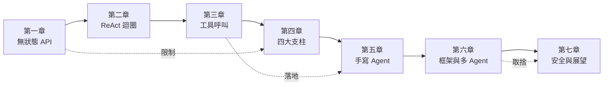
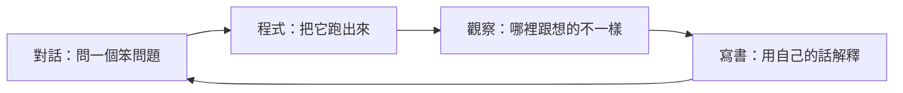

# 前言 (Introduction)

## 0.1 為什麼我們需要從 API 走向 Agent？

把 LLM 當成一個 API 來用，你得到的是**一個函式**：

```text
input  : 一段文字（prompt）
output : 一段文字（completion）
```

這已經很有用——摘要、翻譯、改寫、問答都做得到。但它有個根本限制：**它只會回答，不會完成任務**。

「明天台北適合辦戶外活動嗎？」這個問題，API 能給你一段看似合理的文字；但如果要真的回答，你需要：

1. 查明天台北的天氣（外部資料）
2. 查活動場地的備案規則（企業內部文件）
3. 根據兩者做出判斷（推理）
4. 把結果寫進行事曆（副作用）

這四個動作沒有一個是「生成一段文字」就完成的。它們需要**迴圈、工具、狀態與權限**。這層東西，就是 Agent。

### 三種心態的轉換

| 維度 | 把 LLM 當 API | 把 LLM 當 Agent |
|------|--------------|----------------|
| 交付物 | 一段文字 | 一個完成的狀態變更 |
| 設計單位 | Prompt | 流程（State / Loop / Tool） |
| 失敗模式 | 答得不夠好 | 做錯事、做太多事 |
| 責任歸屬 | 內容審核 | 行動授權與稽核 |
| 成本模型 | 每次呼叫計費 | 每次任務（多輪呼叫）計費 |

對技術決策者而言，最關鍵的不是「模型變聰明了」，而是**你開始把決策權交給一個不確定性的系統**。所以要問的問題從「Prompt 怎麼寫」變成：

- 它**可以做**什麼？（工具清單）
- 它**被允許**做什麼？（權限邊界）
- 它**什麼時候停**？（終止條件）
- 它**做錯了怎麼辦**？（回滾、稽核、人工覆核）

> 一句話：API 是「語言介面」，Agent 是「加了控制迴圈的語言介面」。

---

## 0.2 本書架構與「對話-程式-寫書」學習循環說明

### 全書地圖



全書分成三篇：

- **核心篇（1–3 章）**：從 API 的痛點，一路推導出迴圈與工具。這是在回答「為什麼非得這樣不可」。
- **實踐篇（4–5 章）**：把散落的觀念收斂成「四大支柱」，再用一支不到 200 行的 Python 程式把它們串起來。
- **進階篇（6–7 章）**：當任務變複雜，框架與多 Agent 解決了什麼、又製造了什麼新風險。

### 「對話 → 程式 → 寫書」循環

這本書本身是用一種特定的學習方式產生的，我把這個方法也寫下來，因為它比任何單一章節都更容易遷移到別的主題：



三個階段的具體做法：

| 階段 | 做什麼 | 產出 | 常見陷阱 |
|------|--------|------|---------|
| **對話** | 直接問 AI「ReAct 和 function calling 差在哪？」這類不上手的問題 | 一堆看似懂了的字彙 | 只收集術語，沒有反例 |
| **程式** | 把答案做成一支會動的程式，強迫自己面對現實 | `demo_agent.py` | 只看範例、不改參數 |
| **寫書** | 用自己的話重寫，寫不出來的地方就是還沒懂的地方 | 本書各章 | 直接貼 AI 原文，沒有消化 |

關鍵在第三階段：**「寫得出來」才是理解的判準**。附錄 B 保留了這個過程中的真實提問與修正，你可以對照著看我是怎麼把誤解改掉的。

### 這本書不談什麼

- 不教 Prompt 魔法咒語（例如「你現在是位專家…」的 efficacy 辯論）。
- 不比較特定模型版本的分數（失效太快）。
- 不談微調與訓練細節（那是另一本書）。
- 不假設你會某個框架；第五章刻意**不用框架**，先把原理看清楚。

### 怎麼讀

如果你時間有限，至少讀完各章末尾的 **「給決策者的重點」**。它們都是獨立的，單獨看也能連成一套判斷邏輯。

---

## 給決策者的重點

1. Agent 不是模型升級，是**流程工程**；差別在於有沒有迴圈、工具和終止條件。
2. 風險的性質改變了：從「內容不當」變成「行動不當」，因此需要授權與稽核，不只是審核文字。
3. 成本從「每次呼叫」變成「每次任務」，要多輪預算上限。
4. 用「對話 → 程式 → 寫書」循環學習，強迫自己把模糊 understanding 變成可驗證的產出。
