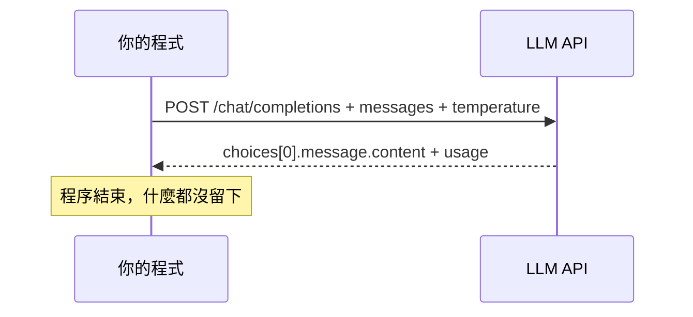
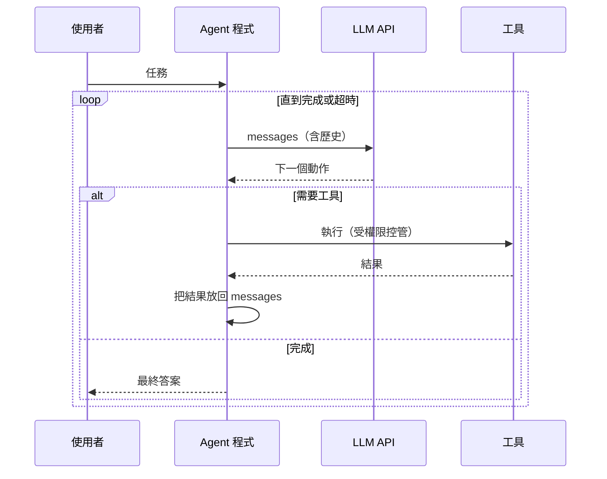

# 第一章：無狀態的 LLM API (Stateless Completions)

> 本章核心：**每一次 API 呼叫都是全新的開始**。Agent 的所有複雜性，某種程度上都是在補這個「失憶」的洞。

## 1.1 大語言模型 (LLM) 的本質：文字接龍與 Token 預測

LLM 做的事，抽象到極致只有一句話：

> 給定前面的 token，預測下一個 token 的機率分布，然後抽一個。

「今天天氣很＿」後面接「好」「熱」「糟」的機率不同；模型學的就是這條機率曲線。一路抽下去，就變成一段看起來像思考的文字。

這裡有三個工程上必須內化的技術事實：

| 技術事實 | 含義 | 對系統設計的影響 |
|---------|------|----------------|
| **Token 不是字** | 中文可能一字一 token，也可能拆成多塊 | 成本與 context 上限用 token 算，不用字數 |
| **輸出是抽樣** | `temperature > 0` 時同題**可能**不同答 | 需要重試、驗證與容錯，不能假設可重現 |
| **Context Window 有限** | 輸入 + 輸出共用同一個額度 | 對話變長就必須裁剪或摘要 |

### temperature 的決策含義

- `temperature = 0`：盡量取機率最高的 token，接近決定性。適合分類、抽取、固定格式。
- `temperature = 0.7~1.0`：保留創造性。適合發想、寫作。
- 在 Agent 裡通常**故意用低值**，因為我們要的是穩定的工具呼叫格式，不是文采。

> 決策者常問：「為什麼同一個 Prompt 有時候當、有時候不當？」答案不是模型壞掉，而是你買的是一個**機率系統**。把它當成會犯錯的同事，不要當成函式。

### Context Window 是工作記憶，不是資料庫

Context window 常被誤解為「模型的記憶」。比較好的比喻是**桌面**：

- 桌面越大，能攤開的資料越多。
- 但桌面不是檔案櫃；沒放上來的資料，模型根本不知道。
- 放太多反而會「找不到重點」（context 稀釋效應）。

所以「把歷史全部塞回去」不是解法，只是把問題往後推。第四章的 Memory 支柱會在這裡接手。

---

## 1.2 什麼是 API？以 Python 發送 HTTP Request / JSON Payload

API（Application Programming Interface）在這裡就是：**用 HTTP 把一段 JSON 送給模型服務，再拿回一段 JSON**。

一個典型的 request payload：

```json
{
  "model": "gpt-4o-mini",
  "messages": [
    { "role": "system", "content": "你是一位精簡的助理。" },
    { "role": "user", "content": "台北明天適合辦戶外活動嗎？" }
  ],
  "temperature": 0.2,
  "max_tokens": 500,
  "stream": false
}
```

回傳（簡化）：

```json
{
  "choices": [
    {
      "message": {
        "role": "assistant",
        "content": "需要天氣資料才能判斷。"
      },
      "finish_reason": "stop"
    }
  ],
  "usage": { "prompt_tokens": 42, "completion_tokens": 12 }
}
```

### 角色 (role) 是協定，不是建議

| role | 誰寫的 | 用途 |
|------|--------|------|
| `system` | 開發者 | 設定行為、格式、權限邊界 |
| `user` | 使用者 | 任務本身 |
| `assistant` | 模型（或你偽造的） | 歷史回覆、Few-shot 範例 |
| `tool` | 你的程式 | 工具執行結果 |

「`assistant` 可以由你偽造」這點很重要：第五章的 ReAct 解析器就是自己組裝歷史訊息，讓模型以為自己剛剛說過 `Thought: ...`。

### 用標準庫送出請求

以下不依賴任何第三方套件，刻意保留 HTTP 的原始樣貌：

```python
import json
import os
import urllib.request

payload = {
    "model": os.environ.get("MODEL", "gpt-4o-mini"),
    "messages": [
        {"role": "system", "content": "你是一位精簡的助理。"},
        {"role": "user", "content": "用一句話解釋什麼是 Agent。"},
    ],
    "temperature": 0.2,
}

req = urllib.request.Request(
    os.environ.get("OPENAI_BASE_URL", "https://api.openai.com/v1")
    + "/chat/completions",
    data=json.dumps(payload).encode("utf-8"),
    headers={
        "Content-Type": "application/json",
        "Authorization": "Bearer " + os.environ["OPENAI_API_KEY"],
    },
)
with urllib.request.urlopen(req, timeout=30) as resp:
    data = json.load(resp)

print(data["choices"][0]["message"]["content"])
```

真正的框架（SDK）只是把這段包起來，並加上重試、串流、錯誤型別。**協定本身沒有變**。

### 一次呼叫的時序



注意最後一行：**API 不記得你**。下一次呼叫時，模型不知道上一次說過什麼。

---

## 1.3 LLM API 的天花板：無記憶、無實時資料、無法影響真實世界

這三個限制不是 bug，是設計上的必然結果。把它們記成「三無」：

### 無記憶 (No Memory)

每個 request 都必須自帶完整歷史。這造成兩個問題：

1. **成本線性成長**：對話越長，每次要付的 prompt tokens 越多。
2. **視窗並非無限**：超過 context 就得丟資料或摘要。

**補償機制**：由程式持有 `messages` 陣列（第五章 5.2），長期記憶靠 RAG（第四章 4.3）。

### 無實時資料 (No Fresh Data)

模型的知識停在訓練資料截止時間，且不知道「今天」發生什麼事。問「現在幾點」它只能猜。

**補償機制**：工具呼叫——搜尋、資料庫查詢、天氣 API（第三章）。

### 無法影響真實世界 (No Side Effects)

API 只回文字。它不能寄信、不能改資料庫、不能寫檔案。這點其實是**好消息**：代表安全邊界可以清楚地畫在「程式執行工具」那一刻。

**補償機制**：Function Calling + 應用程式執行 + 權限控管（第三章 3.3）。

### 限制 → 解法對照表

| 限制 | 直接後果 | 補償機制 | 在哪一章 |
|------|---------|---------|---------|
| 無記憶 | 每次都要重送歷史 | `messages` 陣列 + 摘要 | 1.2 / 4.3 / 5.2 |
| 無實時資料 | 答案過期或幻覺 | Tools / RAG | 3 / 4.3 |
| 無副作用 | 只能「建議」不能「完成」 | Function Calling | 3 / 5.3 |
| 輸出不確定 | 同題可能不同答 | 低溫度 + 驗證 + 重試 | 1.1 / 7.2 |

### 從「一次呼叫」到「多次呼叫」

把上面三個補償機制加上去之後，呼叫型態會變成：



這張圖就是整本書的骨架。接下來的章節只是在回答：**這個迴圈要怎麼設計才不會失控**。

---

## 給決策者的重點

1. LLM API 是**無狀態、機率性、文字輸出**的元件；把它當成會犯錯的同事，不要當成純函式。
2. 成本與 context 用 token 計算，不是字數；對話越長越貴，且需要裁剪策略。
3. 「三無」都有明確補償機制：記憶靠程式持有歷史、即時性靠工具、副作用靠受控執行。
4. 安全邊界最好的位置，是**工具執行那一刻**，不是Prompt裡的「請不要亂來」。
5. 一旦進入多輪迴圈，就必須有終止條件與預算上限——這是第二章與第五章的起點。
