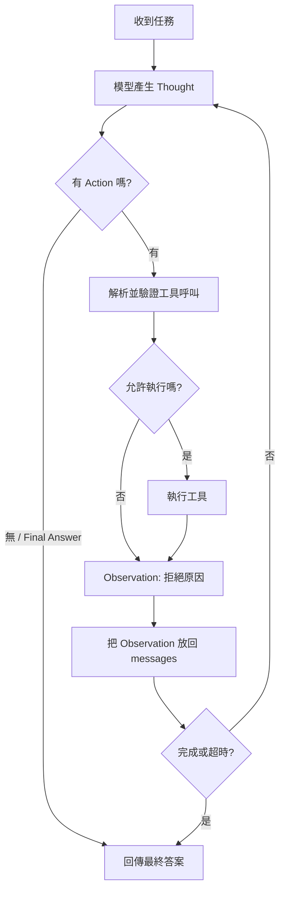

# 第二章：賦予 AI「大腦迴圈」—— ReAct 架構

> 本章核心：**不要一次想完，邊想邊做**。ReAct 把「推理」和「行動」交錯執行，讓每一步都被下一步的現實結果校正。

## 2.1 什麼是 ReAct？Reasoning (思考) + Acting (行動)

ReAct 出自 Yao 等人 2022 年的論文 *ReAct: Synergizing Reasoning and Acting in Language Models*。它觀察到一件很直觀的事：

- 只讓模型「想」（Chain-of-Thought）：想得頭頭是道，但可能建立在錯誤前提上。
- 只讓模型「做」（直接呼叫工具）：動作快，但沒有邏輯，容易亂試。
- **交錯進行**：想一步 → 做一步 → 看結果 → 再想一步。

第三種就是 ReAct。它的價值不在於「更聰明」，而在於**用 observation 即時校正推理**。

### 三種策略比較

| 策略 | 流程 | 優點 | 缺點 | 適用場景 |
|------|------|------|------|---------|
| 單次回答 | Prompt → 答案 | 最快、最便宜 | 無法查資料、幻覺高 | 摘要、改寫 |
| Plan-and-Execute | 先列完整計畫，再逐步執行 | 全域視野、好稽核 | 計畫趕不上變化 | 步驟穩定、可預期 |
| **ReAct** | 想→做→看→想 | 自我校正、容錯好 | 輪次多、成本較高 | 探索性、需查資料的任務 |

> 決策提醒：ReAct 不是「永遠比較好」。如果任務步驟固定（例如每天固定跑同一份報表），用狀態機或 Plan-and-Execute 反而更省、更可控。

---

## 2.2 ReAct 的三大核心步驟：Thought → Action → Observation

一個標準的 ReAct 輪次長這樣：

```text
Thought: 我需要知道明天台北的天氣，才能判斷是否適合戶外活動。
Action: get_weather(city="台北", date="明天")
Observation: {"city":"台北","date":"明天","rain_prob":0.8,"temp":22}

Thought: 降雨機率 80%，不適合戶外；我應該查室內備案。
Action: search(query="台北 室內 活動 場地")
Observation: ["科教館", "華山藝文中心", "市立美術館"]

Thought: 已有足夠資訊，可以給出建議。
Final Answer: 明天台北降雨機率 80%，建議改到室內，例如科教館或華山藝文中心。
```

三個角色各自負責：

| 步驟 | 誰產生 | 內容 | 工程意義 |
|------|--------|------|---------|
| **Thought** | 模型 | 自然語言推理 | 可讀的決策足跡（audit trail） |
| **Action** | 模型 | 工具名 + 參數 | 結構化的「意圖」，尚未執行 |
| **Observation** | **你的程式** | 工具回傳結果 | 把現實拉回模型的事實依據 |

「Final Answer」不是第四個步驟，而是 Action 的替代——代表「不再呼叫工具、準備回覆使用者」的終止輸出。

最容易被忽略的是第三行：**Observation 不是模型寫的，是你的程式寫的**。這代表你可以控制它看到什麼——包括錯誤訊息、截斷的結果、甚至「權限不足」的拒絕。這是第三章安全設計的著力點。

### 迴圈控制流程



### 終止條件：最容易出錯的地方

一個沒有良好終止條件的 ReAct 迴圈會：

- **無限 repeating**：模型一直產生同樣的 Action。
- **工具風暴**：每輪都呼叫三個工具，成本爆掉。
- **永不給答案**：一直「我還需要更多資訊」。

實務上至少要設三道閘：

1. **最大步數**（例如 8 步）— 第五章的 `MAX_STEPS`。
2. **最大成本**（token 預算）— 第七章的預算控管。
3. **重複偵測**（同一 Action 連續 N 次就強制總結）。

> 這些不是「最佳化」，是**上線的必要條件**。沒有終止條件的 Agent 相當於一支 while(true) 的付費程式。

---

## 2.3 零框架實現：如何用 System Prompt 引導模型遵循固定格式

框架常常讓人誤以為「格式解析」很複雜。其實最小可行版本只需要：在 `system` 訊息裡把輸出格式寫死，再給一兩個範例。

### 一個可用的 System Prompt 骨架

```text
你是一個使用工具的助理。每次回覆必須遵循以下格式：

Thought: <你的推理，一行>
Action: <tool_name>(<key>="<value>", ...)
Observation: <由系統填入，不要自己寫>

當資訊足夠時，改為：
Thought: <最後推理>
Final Answer: <給使用者的答案>

可用工具：
- get_weather(city, date)
- search(query)

規則：
1. 一次只能有一個 Action。
2. 不要輸出 Observation，那是系統的工作。
3. 如果工具失敗，Observation 會告訴你原因，請換一個做法。
```

範例（Few-shot）比規則更有效：把上面 2.2 的 trace 直接貼進 `messages` 裡，分成數則 `user` / `assistant` 訊息，模型就會模仿這個節奏。

### 四種格式策略的取捨

| 策略 | 範例 | 解析方式 | 優點 | 缺點 |
|------|------|---------|------|------|
| 自由文字 | 「我先查一下天氣…」 | 很難 | 自然 | 不穩定、不可自動化 |
| **分隔符 + Regex** | `Action: search(query="x")` | 正規表達式 | 零依賴、好除錯 | 括號/引號易出錯 |
| 自訂 JSON | `{"action":"search",...}` | `json.loads` | 結構清楚 | 模型可能加註解破壞 JSON |
| 原生 Function Calling | API 回 `tool_calls` | SDK 解析 | 相對於前述解析法最可靠 | 不同供應商協定不同 |

第五章採用第二種，因為它的目的就是**讓你看見解析這件事本身**。第三章會說明第四種在正式系統中為什麼更常見。

### 零框架的邊界

用手寫 Prompt + Regex 你會很快碰到：

- 模型在 `Action:` 後面多寫了一句話 → regex 抓到錯的參數。
- 模型把 `Observation:` 也自己編出來 → 幻覺被「合法化」。
- 模型改用繁體/簡體混寫的關鍵字 → 解析器認不出來。

解法不是寫更長的 Prompt，而是**把格式交給 API 協定**（Function Calling / Structured Output）。但在那之前，先親手寫一次，你才會知道協定到底幫你做了什麼。

---

## 給決策者的重點

1. ReAct 的價值是「用 Observation 校正推理」，不是讓模型想得更久。
2. **Observation 由你的程式產生**，所以它是安全邊界與事實來源的入口。
3. 上線前必須有三道終止閘：步數、成本、重複偵測；否則就是一支會燒錢的無限迴圈。
4. 格式策略的選擇是工程取捨：Regex 適合學習與原型，Function Calling 適合正式系統。
5. 若任務步驟固定，狀態機 / Plan-and-Execute 比 ReAct 更可控、更便宜。
