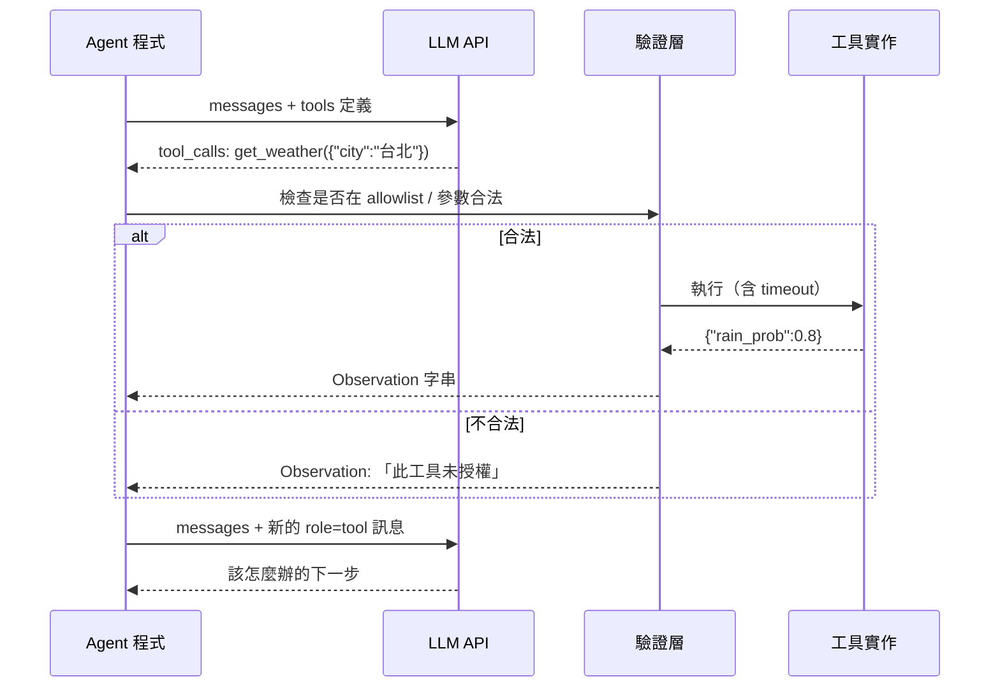
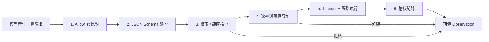

# 第三章：工具呼叫 (Function Calling / Tool Use)

> 本章核心：**模型只負責「表達意圖」，程式才負責「執行動作」**。這條分界線是整個 Agent 安全模型的基礎。

## 3.1 讓 LLM 擁有雙手：將 Python Function 抽象化為工具描述

工具（tool）不是把 Python 函式直接丟給模型。模型看不懂你的 source code，它只看得懂**描述（schema）**。

一個工具定義通常包含三件事：

| 欄位 | 內容 | 誰讀 |
|------|------|------|
| `name` | 工具識別字，例如 `get_weather` | 模型用來選擇、程式用來分派 |
| `description` | 自然語言說明「何時該用」 | 模型讀（這是決策依據） |
| `parameters` | JSON Schema，定義參數型別與限制 | 模型讀 + 程式驗證 |

### 從 Python 函式到工具描述

假設你有一個函式：

```python
def get_weather(city: str, date: str) -> dict:
    ...
```

對應的工具描述（簡化）：

```json
{
  "name": "get_weather",
  "description": "查詢指定城市與日期的天氣。當使用者問到天氣、降雨、氣溫時使用。",
  "parameters": {
    "type": "object",
    "properties": {
      "city": {"type": "string", "description": "城市名稱，例如 台北"},
      "date": {"type": "string", "description": "日期，例如 明天 或 2026-11-28"}
    },
    "required": ["city", "date"]
  }
}
```

注意 `description` 寫的是**使用時機**，不是函式實作。模型是靠這句話決定要不要呼叫它。描述寫得模糊，工具永遠不會被用；描述寫得太貪心，模型什麼都呼叫它。

### 工具粒度的決策

| 粒度 | 例子 | 優點 | 風險 |
|------|------|------|------|
| 太細 | `get_temp`, `get_rain`, `get_wind` | 單純、好測試 | 一個問題要呼叫三次，成本高 |
| **適中** | `get_weather(city, date)` | 語意完整、一次到位 | 需要設計回傳格式 |
| 太粗 | `do_everything(request)` | 模型很愛用 | 權限難切、除錯困難、風險大 |

實務建議：**以「使用者的一次意圖」為單位設計工具**。這也讓權限控管有明確的單位可以授權。

---

## 3.2 結構化輸出：JSON Schema 的定義與解析

有兩件常被混為一談的事，先分開：

| 項目 | 目的 | 典型 API 欄位 |
|------|------|--------------|
| **Structured Output** | 讓最終答案符合某個格式 | `response_format` |
| **Function Calling / Tool Use** | 讓模型表達「想呼叫某個函式」 | `tools` / `tool_calls` |

前者是「回答的格式」，後者是「動作的請求」。兩者都靠 JSON Schema，但語意不同。

### 一次工具呼叫的完整生命周期



關鍵在於：**模型回傳的 `tool_calls` 只是一個字串化的意圖**。它沒有執行任何東西。真正碰到外部世界的是 `V → T` 那一步，而那一步完全是你的程式。

### 把 Observation 放回訊息歷史

工具執行完之後，必須把結果以 `role: "tool"` 放回 `messages`，否則模型不知道剛剛發生什麼：

```python
messages.append({
    "role": "assistant",
    "tool_calls": response["choices"][0]["message"]["tool_calls"],
})
messages.append({
    "role": "tool",
    "tool_call_id": call["id"],
    "content": json.dumps(result, ensure_ascii=False),
})
```

第五章的零框架版不用 `tool_call_id`，而是直接把 Observation 拼成一段 `user` 訊息；原理完全一樣——**歷史裡必須有工具結果**。

### 常見的解析陷阱

- 模型回傳的 arguments 是**字串**，不是 dict，要 `json.loads`。
- 模型可能漏填 `required` 欄位 → 要在程式端再驗一次，不要相信模型。
- 模型可能幻覺出不存在的工具名 → allowlist 比對是必要的。
- `finish_reason` 可能是 `tool_calls` 而不是 `stop` → 不能只看內容有沒有值。

---

## 3.3 實作安全邊界：工具執行的權限控管與錯誤捕捉

如果說 ReAct 迴圈是引擎，安全邊界就是煞車。主要煞車要裝在**工具執行前**，稽核紀錄則在執行後；兩者都不能只靠 Prompt。

### 六道防線



| 防線 | 防止什麼 | 實作方式 |
|------|---------|---------|
| Allowlist | 幻覺工具、惡意 Tool 名 | 只在註冊表裡查找 |
| Schema 驗證 | 型別錯誤、注入參數 | `jsonschema` 或手動檢查 |
| 權限 / 範圍 | 刪掉不該刪的資料 | 每個工具綁定角色與資源範圍 |
| 預算限制 | 工具風暴、成本爆量 | 每任務呼叫次數與 token 上限 |
| Timeout / 隔離 | 無限等待、破壞性副作用 | 子程序、容器、唯讀掛載 |
| 稽核紀錄 | 事後無法追責 | 記錄 who / what / when / result |

### 錯誤也是 Observation，不是例外

這是初學者最常做錯的一件事：工具炸了就讓整個程式 crash。正確做法是**把錯誤變成模型看得懂的 Observation**：

```python
try:
    result = tool_registry[name](**args)
except Exception as e:
    result = {"ok": False, "error": f"{type(e).__name__}: {e}"}
```

為什麼？因為 ReAct 的價值就是「看到現實後再想」。告訴模型「查無此城市，請改用英文名」它可以修正；直接拋 exception 只會讓整條任務消失。

但要注意：**不是所有錯誤都該回傳給模型**。涉及機敏資訊的錯誤（例如連線字串、API key 片段）要改成通用訊息，細節寫進伺服器日誌。第五章的示範工具不會拋出機敏錯誤，因此省略了這層過濾；正式系統必須補上。

### 需要人工覆核的動作

並非所有工具都適合自動執行。用一個簡單的分類：

| 動作類型 | 例子 | 建議 |
|---------|------|------|
| 唯讀 | 查天氣、查文件 | 可自動 |
| 可逆的寫入 | 加入購物車、建立草稿 | 可自動 + 紀錄 |
| 不可逆 / 高影響 | 寄信、付款、刪除資料 | 人工 approve 後才執行 |

對決策者來說，這張表比任何框架選型都重要：**它定義了 Agent 的責任邊界**。

---

## 給決策者的重點

1. 工具是「描述 + 驗證 + 實作」三件套；模型的 `tool_calls` 只是意圖，執行權永遠在你的程式裡。
2. 工具粒度以「一次使用者意圖」為單位，太大難控權限，太小成本高。
3. Structured Output 管的是回答格式，Function Calling 管的是動作請求，兩者別混。
4. 安全邊界以**執行前**為主、**執行後**稽核收尾：allowlist、schema、權限、預算、timeout、稽核，六道缺一不可。
5. 把可修正的錯誤變成 Observation 讓 Agent 自我修復；把機敏錯誤過濾後寫日誌。
6. 不可逆動作（付款、寄信、刪除）必須有人類 approve 關卡。
