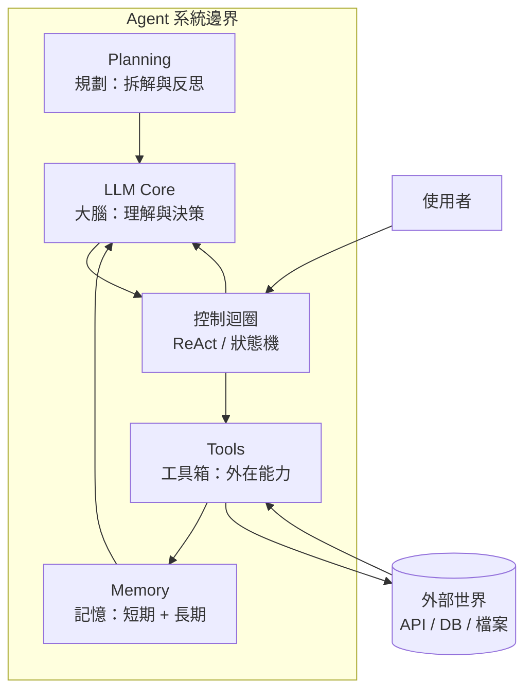
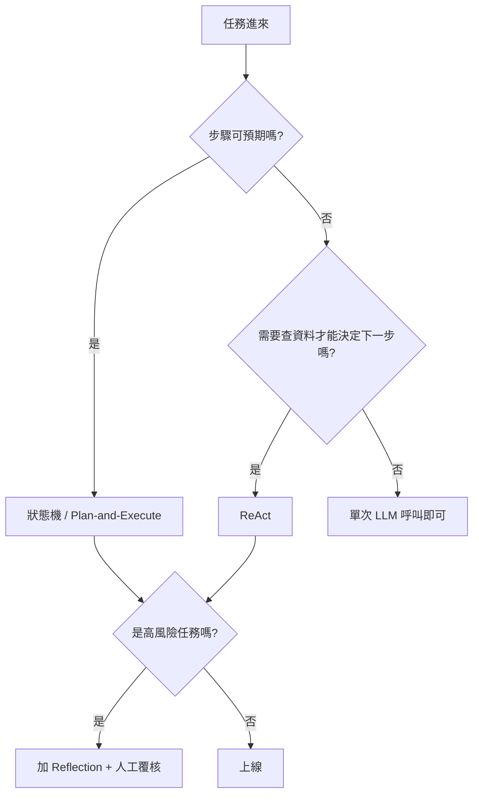
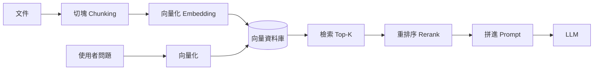

# 第四章：Agent 的四大支柱 (Architectural Pillars)

> 本章核心：把前三章的推導收斂成一張架構圖。**LLM Core / Planning / Memory / Tools** 不是四個套件，而是四種必須被明確設計的責任。

## 4.1 全景：四大支柱的關係



一個常見的誤解是「LLM 就是 Agent」。從圖上看，LLM 只是其中一塊；真正讓系統變成 Agent 的是**控制迴圈**，以及它與其他三塊的資料流。

| 支柱 | 回答的問題 | 缺失時會怎樣 |
|------|-----------|-------------|
| LLM Core | 「現在該做什麼？」 | 沒有決策能力 |
| Planning | 「大的任務怎麼拆？」 | 卡在細節、迷失目標 |
| Memory | 「之前發生過什麼？」 | 反覆問同樣的問題 |
| Tools | 「怎麼碰到現實？」 | 只能紙上談兵 |

---

## 4.2 LLM Core（大腦）：模型選擇與 Prompt Engineering

### 模型選擇的五個維度

| 維度 | 問題 | 決策考量 |
|------|------|---------|
| 能力 | 能否遵循複雜格式？ | 工具呼叫多時，格式遵循比知識更重要 |
| 延遲 | 每輪要等多久？ | ReAct 多輪，單輪 2 秒 × 8 輪 = 16 秒 |
| 成本 | 每 token 多少？ | 任務成本 = 輪數 × (輸入 + 輸出) token |
| 上下文 | 窗口多大？ | 影響能帶多少歷史與文件 |
| 治理 | 資料是否留在合規區域？ | 企業常被這條直接淘汰某些供應商 |

> 決策者視角：在多輪工具呼叫場景下，模型選擇通常**不是選最強的，而是選「格式最穩、延遲最低、成本可預期」的**。第五章的範例用低溫度就是為了這個；單次寫作任務的取捨不同。

### Prompt 分層

```text
[System]  不變的規則：角色、格式、工具清單、安全邊界
[Developer] 本次任務的政策：語氣、輸出長度、稽核要求
[User]    使用者原始輸入
[History] 先前 Thought / Action / Observation
```

分層的好處：**安全規則放在最上層，可降低被使用者輸入覆蓋的機率，但不能當作安全保證**。第七章談 Prompt Injection 時會說明為什麼。

### 模型路由（進階但很實用）

不是所有步驟都要用同一個模型：

- 第一步「判斷意圖」用小模型。
- 中間「工具調用格式」用格式遵循強的模型。
- 最後「總結給使用者」用表達能力好的模型。

這就是一個**模型級的狀態機**，成本可以降一個數量級。

---

## 4.3 Planning（規劃）：任務拆解、Sub-goals 與 Reflection

### 三種規劃型態

| 型態 | 做法 | 優點 | 代價 |
|------|------|------|------|
| Implicit | 不特別做，讓 ReAct 邊走邊想 | 最簡單 | 容易迷失在大任務 |
| Plan-and-Execute | 先產出步驟清單再執行 | 好稽核、可暫停 | 計畫過時不會自動改 |
| Reflection | 執行後讓模型自我批評再修 | 品質較高 | 多一輪成本、可能自我說服 |

### 何時該加 Planning



實務經驗：**我遇到的案例中，有許多聲稱需要多 Agent 的場景，其實只是需要一個好的 Planning 步驟**。是否成立仍要看是否有上下文隔離與並行需求；先把這層做對，再考慮第六章的複雜拓樸。

### Sub-goals 的表示

把大目標拆成可檢查的小目標，有個額外好處：進度可視化。

```json
{
  "goal": "幫我安排明天活動",
  "sub_goals": [
    {"id": 1, "desc": "查天氣", "done": true},
    {"id": 2, "desc": "找室內備案", "done": true},
    {"id": 3, "desc": "產出建議", "done": false}
  ]
}
```

這份結構可以同時作為狀態機的狀態、稽核紀錄、以及中斷後恢復的檢查點。

---

## 4.4 Memory（記憶）：短期記憶與長期記憶 (RAG)

### 短期記憶：Context Window 管理

短期記憶的載體是 `messages` 陣列，它佔用的是 context window 的額度。問題是它會一直長大。三種常見策略：

| 策略 | 做法 | 風險 |
|------|------|------|
| 滑動窗口 | 只保留最近 N 則 | 忘記一開始的目標 |
| 摘要 | 把舊對話濃縮成一則 | 摘要本身可能失真 |
| 結構化狀態 | 只保留欄位（如 sub_goals） | 需要事先設計 schema |

最好的做法通常是**混合**：結構化狀態 + 最近對話 + 舊對話摘要。

### 長期記憶：RAG

RAG（Retrieval-Augmented Generation）不是「讓模型記住」，而是「需要的時候查得到」：



設計 RAG 時，真正難的不是選資料庫，而是：

- **切塊大小**：太大 noisy，太小失去上下文。
- **檢索評估**：你怎麼知道找回來的對？（第七章的 Eval）
- **新鮮度**：文件更新後索引是否同步？
- **權限**：不同使用者能查到的文件是否相同？（常被忽略的資安洞）

> 記憶不是資料庫，是**檢索策略**。把「記住」改成「找得到」，架構就清楚了。

---

## 4.5 Tools（工具箱）：Web Search、Code Interpreter、Custom APIs

工具層的設計重點是**註冊表（registry）**：

```python
TOOLS = {
    "get_weather": get_weather,
    "search": search,
    "calculator": calculator,
}
```

註冊表同時承擔四個角色：

1. **能力清單**：告訴模型有什麼可用。
2. **分派表**：把名字映射到真正的函式。
3. **權限邊界**：只有註冊過的能執行（allowlist）。
4. **觀測點**：在這裡插入 log、計時、預算計數。

三類常見工具：

| 類型 | 例子 | 特殊風險 |
|------|------|---------|
| Web Search | 搜尋引擎、爬蟲 | 來源可信度、Prompt Injection |
| Code Interpreter | 執行 Python | 沙箱逃逸、資源耗盡 |
| Custom API | 公司內部系統 | 權限過大、資料外洩 |

---

## 給決策者的重點

1. Agent = LLM Core + Planning + Memory + Tools，再由**控制迴圈**串接；迴圈是機制而非第五支柱，但少它一樣退化。
2. 模型選擇看的是格式遵循、延遲、成本、上下文與治理，不一定是「最強模型」。
3. 安全規則放 System 層，使用者的話放 User 層，兩者不要混在一起。
4. 大多數「需要多 Agent」的需求，先用 Planning + 狀態機就能解決。
5. 短期記憶要裁剪，長期記憶要檢索；RAG 的難點是切塊、評估與權限，不是資料庫選型。
6. 工具註冊表是最好的控制點：能力、分派、權限、觀測一次到位。
