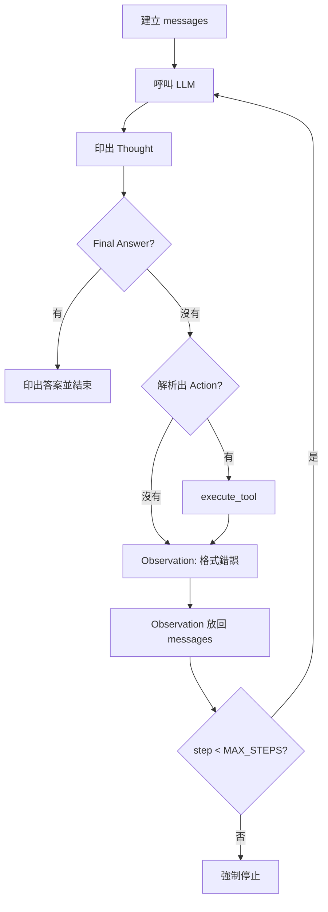

# 第五章：手寫第一個 ReAct Agent (Minimal Viable Agent)

> 本章核心：把前四章的觀念濃縮成一支能跑的程式。**不用任何 Agent 框架**，只用 Python 標準庫，你才會看見框架幫你做了什麼。

完整原始碼見[附錄 A](demo_agent.py)。以下按功能切片解說。

## 5.1 專案結構與環境設定 (`demo_agent.py`)

```text
12/
├── README.md              # 本書目錄
├── 00-introduction.md     # 前言
├── 01-stateless-llm-api.md
├── 02-react-architecture.md
├── 03-function-calling.md
├── 04-architectural-pillars.md
├── 05-minimal-react-agent.md
├── 06-frameworks-and-multi-agent.md
├── 07-conclusion.md
├── demo_agent.py          # 附錄 A：本章範例
└── conversation_log.md    # 附錄 B：對話紀錄
```

環境需求只有一項：**Python 3.10+**（型別註記用到 `|` 語法）。不需要 `pip install`，因為 HTTP、JSON、Regex 都來自標準庫。

### 兩種執行模式

```bash
python demo_agent.py --mock
```

```bash
set OPENAI_API_KEY=你的金鑰
python demo_agent.py --question "高雄明天適合戶外嗎？"
```

macOS / Linux 請改用 `export OPENAI_API_KEY=你的金鑰`。

`--mock` 模式用內建的三輪回應，完全不打網路。它的目的不是「假裝很厲害」，而是讓你能專心觀察**迴圈怎麼把 Thought / Action / Observation 串起來**。注意：`--mock` 固定使用台北情境的內建回應，`--question` 只在連接真實 API 時生效。

> 為了一支能跑的範例而犧牲真實性值得嗎？我認為值得：除錯時你能確定問題出在解析器，而不是 API 金鑰或網路。

---

## 5.2 實作 LLM 對話通訊與歷史紀錄維持

`call_llm()` 就是第一章那段 `urllib` 請求的包裝，差別在於多了 HTTPError 的處理：

```python
def call_llm(messages: list[dict[str, str]]) -> str:
    payload = {
        "model": MODEL,
        "messages": messages,
        "temperature": 0.2,
        "max_tokens": 800,
    }
    ...
    return body["choices"][0]["message"]["content"]
```

三個設計決定：

| 決定 | 值 | 原因 |
|------|----|----|
| `temperature` | 0.2 | 要穩定的工具格式，不要文采 |
| `max_tokens` | 800 | 防止單輪輸出暴走 |
| HTTP timeout | 60 秒 | 不要在 Agent 迴圈裡無限等待 |

### 歷史由程式持有

`run()` 一開始建立 `messages`，之後每一輪都往裡加東西：

```python
messages: list[dict[str, str]] = [
    {"role": "system", "content": SYSTEM_PROMPT},
    {"role": "user", "content": question},
]
```

每輪結束前，一定會做兩件事：

```python
messages.append({"role": "assistant", "content": response})

messages.append(
    {"role": "user", "content": "Observation: " + observation_text}
)
```

這正是第一章「API 無記憶」的解法：**模型不需要記得，程式記得就好**。

注意這裡用 `role: "user"` 裝 Observation，而不是正式 Function Calling 的 `role: "tool"`。零框架版刻意簡化；第三章的正式做法比較嚴謹，但原理相同——**工具結果必須出現在歷史裡**。

### `mock` 如何知道現在是第幾輪

```python
def call_llm_mock(messages: list[dict[str, str]]) -> str:
    used = sum(1 for message in messages if message["role"] == "assistant")
    index = min(used, len(MOCK_TURNS) - 1)
    return MOCK_TURNS[index]
```

它數的是「已經有幾個 assistant 訊息」。這剛好等於已跑過的輪數——一個很便宜但有效的狀態推導技巧。

---

## 5.3 正規表達式 (Regex) 解析 `Action: tool_name(arg)`

`SYSTEM_PROMPT` 把輸出格式釘死，`parse_action()` 負責把它拆開：

```python
ACTION_RE = re.compile(r"Action:\s*([A-Za-z_]\w*)\s*\(([^)]*)\)", re.S)
ARG_RE = re.compile(r"([A-Za-z_]\w*)\s*=\s*\"([^\"]*)\"")
FINAL_RE = re.compile(r"Final Answer:\s*(.*)", re.S)

def parse_action(text: str) -> tuple[str, dict[str, str]] | None:
    match = ACTION_RE.search(text)
    if match is None:
        return None
    args = {key: value for key, value in ARG_RE.findall(match.group(2))}
    return match.group(1), args
```

三條 regex 各自負責：

| Regex | 抓什麼 | 輸出 |
|-------|--------|------|
| `ACTION_RE` | `Action: get_weather(...)` | 工具名 + 參數字串 |
| `ARG_RE` | `city="台北"` | dict of string |
| `FINAL_RE` | `Final Answer: ...` | 最終答案 |

`([^)]*)` 刻意不允許括號嵌套，這讓解析器保持簡單；代價是工具參數不能包含右括號。這是個**有意識的取捨**，不是疏忽。

### 從意圖到執行

`execute_tool()` 示範了第三章六道防線中最核心的三道：

```python
def execute_tool(name: str, args: dict[str, str]) -> dict[str, Any]:
    if name not in TOOLS:
        allowed = ", ".join(TOOLS)
        return {"ok": False, "error": f"工具 {name} 不存在。可用工具：{allowed}。"}
    try:
        return TOOLS[name](**args)
    except TypeError as exc:
        return {"ok": False, "error": f"參數錯誤：{exc}"}
    ...
```

它做了三件關鍵的事：

1. **Allowlist**：不在 `TOOLS` 裡的直接拒絕（防幻覺工具名）。
2. **參數驗證**：靠函式簽章與 `TypeError` 擋掉漏填參數。
3. **錯誤降級**：例外變成 `{"ok": False, "error": ...}`，而不是讓程式崩潰。

`calculator()` 裡用 `re.fullmatch` 限制只接受「兩數 + 一個運算子」，而不是用 `eval()`——這就是第三章說的「輸入驗證」。

---

## 5.4 閉環控制迴圈 (Closed-Loop Loop) 測試與除錯

`run()` 的主迴圈是整支程式的核心：



### 實際執行輸出（mock 模式）

```text
任務：明天台北適合辦戶外活動嗎？
模式：mock    最大步數：8

[Step 1] LLM
Thought: 需要先知道明天台北的天氣，才能判斷是否適合戶外活動。
Action: get_weather(city="台北", date="明天")
[Observation] {"city": "台北", "date": "明天", "rain_prob": 0.8, "temp": 22}

[Step 2] LLM
Thought: 降雨機率 80%，不適合戶外；我該找室內備案。
Action: search(query="台北 室內 活動 場地")
[Observation] {"query": "台北 室內 活動 場地", "results": ["科教館", "華山藝文中心", "市立美術館"]}

[Step 3] LLM
Thought: 已有天氣與室內備案，可以下結論了。
Final Answer: 明天台北降雨機率 80%、氣溫 22°C，不建議戶外活動；
可改到科教館、華山藝文中心或市立美術館。
```

### 四個最常見的 bug

| 症狀 | 原因 | 修正 |
|------|------|------|
| 模型一直重複同一個 Action | Observation 沒放回 `messages` | 檢查 5.2 的兩個 `append` |
| 解析永遠失敗 | 模型用了單引號或多行引數 | 放寬 `ARG_RE` 或改 Function Calling |
| 程式跑到第 8 步才停 | 沒有明確的 Final Answer 指示 | 在 System Prompt 加「資訊足夠就回答」 |
| 工具 exception 直接崩潰 | 忘了包 try/except | 讓錯誤變成 Observation |

### 動手改三個地方

建議你依序實驗，每次只改一項：

1. 把 `MAX_STEPS` 改成 2 → 看強制停止的訊息。
2. 在 `SYSTEM_PROMPT` 刪掉工具清單 → 看模型是否還能選對工具。
3. 把 `get_weather("台北", "明天")` 的資料刪掉 → 看模型如何處理錯誤 Observation 並換做法。

這三個實驗分別對應第二章的終止條件、第三章的工具描述、第三章的錯誤降級。**能自己解釋這三個輸出，你就真的懂 Agent 了。**

---

## 給決策者的重點

1. 一個可運作的 Agent 只需要：API 呼叫、訊息歷史、格式解析、工具註冊表、終止條件。
2. 歷史必須由程式持有；Observation 忘了放回歷史，是最常見的除錯地雷。
3. Regex + System Prompt 適合原型與教學；正式系統應改用 Function Calling（第三章）。
4. 工具執行要 allowlist、驗參數、抓例外；錯誤要變成 Observation，不要讓流程中斷。
5. 用 `--mock` 把不確定性隔離掉，除錯時才能確定問題在流程而非模型。
