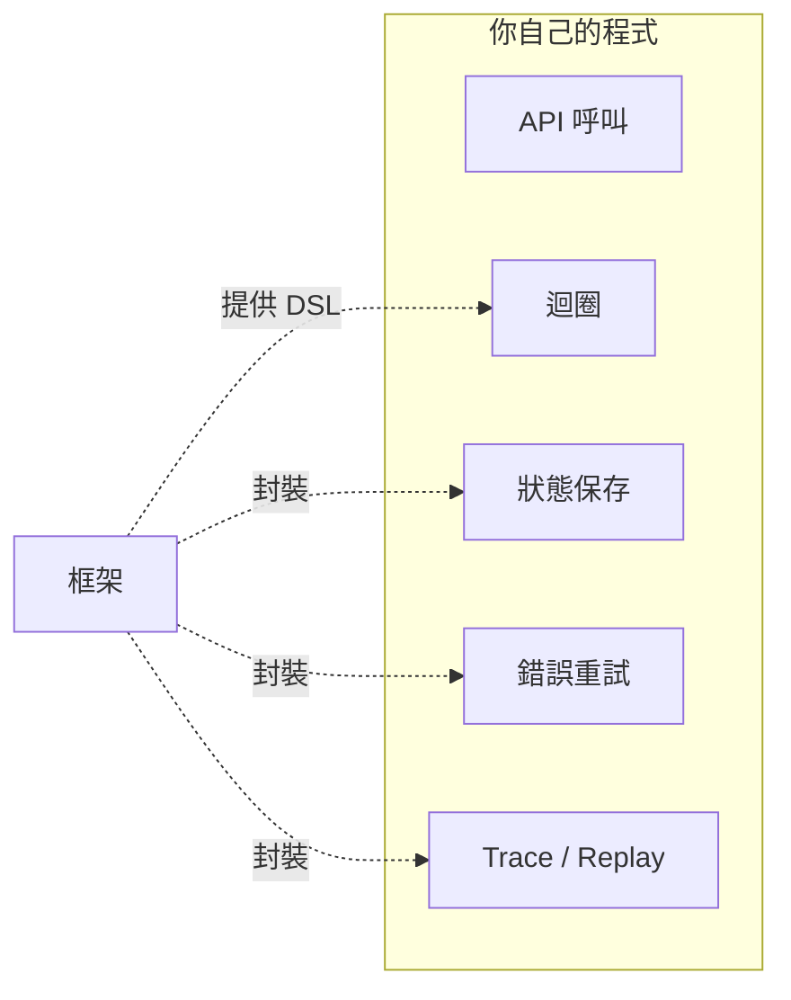
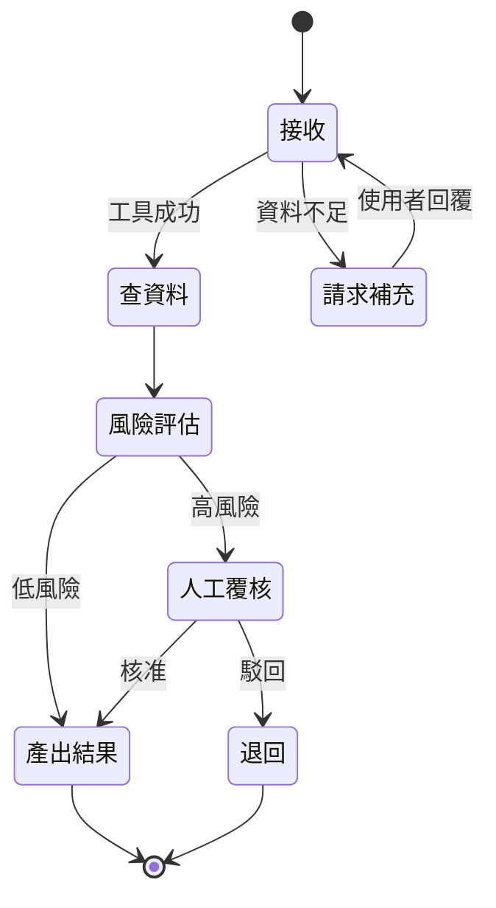
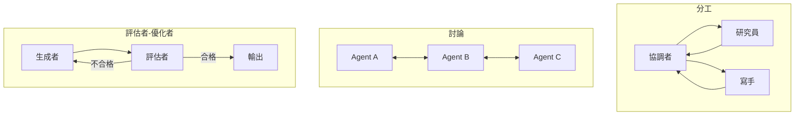

# 第六章：主流 Agent 框架與多 Agent 協作 (Multi-Agent Systems)

> 本章核心：框架買到的是**流程控制與可觀測性**，不是智慧。先問「我的流程有多複雜」，再決定要不要付框架的學習成本。

## 6.1 為什麼需要框架？LangGraph、CrewAI 與 AutoGen 比較

第五章的 `demo_agent.py` 大約 200 行。當你開始需要：

- 中斷後從檢查點恢復
- 分支、並行、迴圈交錯的流程
- 人工審核插入在某個節點
- 逐步 trace 與重放

這時手寫 `while` 迴圈就會開始變形，框架的價值在這裡。

### 三個框架的心智模型

| 框架 | 核心抽象 | 適合什麼 | 代價 |
|------|---------|---------|------|
| **LangGraph** | 圖 / 狀態機（node + edge + state） | 需要精確控制流程、checkpoint、human-in-the-loop | 較低階，要自己畫圖 |
| **CrewAI** | Role + Task + Crew | 角色分工明確、快速原型 | 底層流程較不透明 |
| **AutoGen** | Agent 之間的對話事件 | 多agent 討論、程式執行協作 | 對話容易發散、除錯噪訊多 |

> 版本提醒：框架 API 演變很快，上表描述的是**設計哲學**而非精確 API。選型前請以官方文件與實際 POC 為準。

### 框架真正賣的東西



注意：**A（API 呼叫）永遠還在**。框架沒有消滅 LLM 的不確定性，只是把處理不確定性的樣板程式收斂起來。

### 選型判準（按順序問）

1. 我的流程是否**固定且可畫成圖**？→ 是：LangGraph 類的狀態機。
2. 我是否只是要**快速驗證角色分工**？→ 是：CrewAI 類的角色框架。
3. 我是否需要**agent 互相辯論 / 執行程式**？→ 是：AutoGen 類的對話框架。
4. 以上都不是？→ **不要用框架**，第五章的 200 行就夠。

---

## 6.2 狀態機 (State Machine) 在 Agent 流程控制中的應用

狀態機是決策者最該熟悉的抽象，因為它把「模型的不確定」關進「流程的確定」裡。

### 一個申請審核 Agent 的狀態圖



### 為什麼狀態機比 `while` 迴圈好

| 維度 | while 迴圈 | 狀態機 |
|------|-----------|--------|
| 可視化 | 只能讀程式 | 一張圖就能跟 stakeholder 討論 |
| 測試 | 靠 mock 時序 | 每個節點可獨立測 |
| 中斷恢復 | 要自己序列化 | 狀態即檢查點 |
| 人機關卡 | 到處插 if | 就是一個節點 |
| 責任歸屬 | 模糊 | 每個轉換有明確觸發條件 |

對技術決策者而言，**狀態機是一份可執行的需求文件**。這一點比「框架支援多少工具」重要得多。

### 狀態設計的建議

- 狀態要**可序列化**（dict / dataclass），才能 checkpoint。
- 把「模型判斷」和「狀態轉換」分開：模型建議，程式決定是否轉換。
- 每個轉換都要有**守衛條件**（guard），例如「風險分數 > 0.7」（門檻需由歷史資料校準，此處只是示意）。

```python
def should_escalate(state: dict) -> str:
    return "人工覆核" if state["risk_score"] > 0.7 else "產出結果"
```

這個函式是純邏輯、可單元測試——它把最關鍵的決策從 Prompt 裡拿出來了。

---

## 6.3 多 Agent 協作模式：分工、討論與評估者機制

### 三種常見拓樸



| 模式 | 適用條件 | 主要風險 |
|------|---------|---------|
| 分工 | 子任務需要不同工具或不同上下文 | 協調者成為瓶頸 |
| 討論 | 開放式問題、需要多角度 | 對話發散、成本高 |
| Evaluator-Optimizer | 有明確品質標準（如通過測試） | 評估者本身也會錯 |

### 什麼時候**不**該用多 Agent

這是本節最重要的一句話：

> 如果一個 Agent 加上好的工具和狀態機就能完成，不要拆成三個 Agent。

多 Agent 會同時放大四件事：

1. **成本**：3 個 agent × 5 輪 = 15 次呼叫。
2. **延遲**：串行對話時相乘。
3. **失敗面**：任一個 agent 幻覺，錯誤會被其他 agent 當成事實。
4. **責任模糊**：出錯時很難說是誰的判斷。

### 真正需要多 Agent 的三個訊號

| 訊號 | 例子 | 為什麼單一 Agent 不夠 |
|------|------|---------------------|
| 上下文隔離 | 稽核員不該看到使用者的情緒對話 | context 一旦污染就洗不掉 |
| 並行 | 同時查 5 個系統 | 延遲從相加變成取最大 |
| 專業化 | 財務規則與法規規則分開維護 | Prompt 太長會稀釋注意力 |

Evaluator-Optimizer 特別值得推薦，因為它把「品質」變成一個可觀測的迴圈：生成者寫程式 → 評估者跑測試 → 失敗就帶著錯誤回去改。測試結果是**天然的 Observation**——前提是測試本身完整可信——比另一個 LLM 的意見可靠。

---

## 給決策者的重點

1. 框架提供的是流程控制、檢查點與觀測，不是模型智慧；先確認你真的需要這些。
2. 選型順序：固定流程 → 狀態機框架；快速分工驗證 → 角色框架；需要辯論 → 對話框架；都不需要 → 不要框架。
3. 狀態機是可執行的需求文件，能把不確定的模型判斷關進確定的流程。
4. 把關鍵決策寫成純函式守衛條件，才能單元測試與稽核。
5. 多 Agent 放大成本、延遲、幻覺傳播與責任模糊；先試「單 Agent + 好工具 + 狀態機」。
6. Evaluator-Optimizer 是最值得採用的模式，尤其是有測試/規則可當作客觀 Observation 時。
