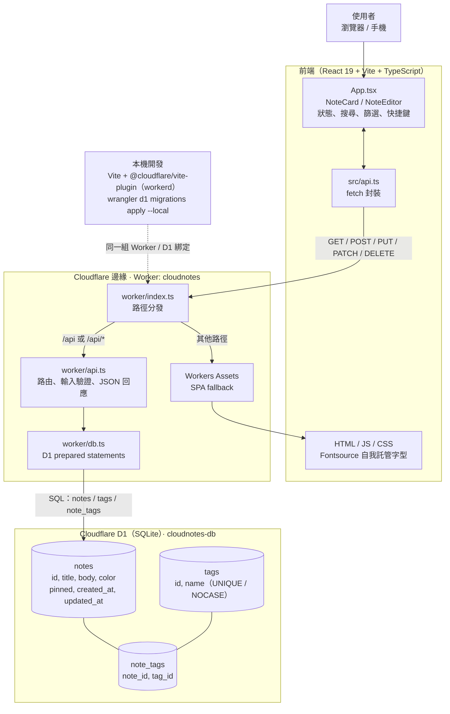

# 期末繳交作品 README

| 項目 | 內容 |
| --- | --- |
| 主要作品 | **Field Notes — 紙張質感的雲端筆記網站**（第 9 週） |
| 上線網址 | https://cloudnotes.fieldnotebook.workers.dev |
| 原始碼 | `09/` · https://github.com/znn-07/_se/tree/main/09 |
| 作業統整網站 | 附錄 |

---

## 一、主要作品：Field Notes

### 1.1 作品簡介

Field Notes 是一個「紙張質感」的雲端筆記網站。前端是 React 19 + Vite + TypeScript，後端是 Cloudflare Worker，資料存放在 Cloudflare D1（SQLite）。整套服務（靜態網站 + API + 資料庫）都跑在 Cloudflare 邊緣平台上，不需自架伺服器。

設計目標是讓筆記介面像紙本筆記本：紙色卡片、字型層級、微微傾斜的卡片與顆粒背景；功能上則保持單純，專注在「快速記下、之後找得到」。

| 項目 | 內容 |
| --- | --- |
| 平台上線 | Cloudflare Workers + Workers Assets + D1 |
| Worker 名稱 | `cloudnotes` |
| D1 資料庫 | `cloudnotes-db`（SQLite；`wrangler.jsonc` 記錄 database_id） |
| 前端框架 | React 19、Vite 8、TypeScript 5.9 |
| 字型 | Fraunces / Newsreader / JetBrains Mono，以 Fontsource 自我託管 |
| 圖示 | lucide-react |
| 開發方式 | 使用 opencode 協助製作 |

### 1.2 功能

- 筆記新增、編輯、刪除；雙擊卡片即可編輯。
- 6 種紙張顏色（`paper`、`butter`、`rose`、`sage`、`sky`、`ink`）。
- 釘選筆記（pinned），釘選者排在前面。
- 每則筆記最多 8 個標籤；標籤列表附使用次數，可點擊篩選。
- 即時搜尋標題、內文與標籤（在前端對已載入資料做過濾）。
- 快捷鍵：`N` 新增、`/` 聚焦搜尋、`Cmd/Ctrl + Enter` 儲存、`Esc` 關閉編輯器。
- 載入骨架、錯誤重試、Toast 提示、響應式版面。

### 1.3 系統架構圖（Mermaid）



架構要點：
1. 瀏覽器只與同一個 `workers.dev` 網域溝通：靜態資源由 Workers Assets 回傳，`/api/*` 才交給 Worker 處理。
2. `worker/index.ts` 是單一入口，判斷路徑後分流到 API 或靜態資源，`wrangler.jsonc` 設定 `not_found_handling: single-page-application`，讓前端路由不會 404。
3. `worker/api.ts` 負責 HTTP 路由、CORS、JSON 解析與輸入驗證（標題最多 200 字、內文最多 20,000 字、標籤最多 8 個且去重、顏色限定枚舉），錯誤統一轉成 400 / 404 / 405 / 500。
4. `worker/db.ts` 用參數化 prepared statements 存取 D1，避免 SQL 注入；查詢用 `bind()`，標籤寫入採用 `INSERT OR IGNORE`。
5. 本機開發時 `@cloudflare/vite-plugin` 啟動 workerd，讓 `/api` 打到本機 SQLite；部署後同一份程式碼打到遠端 D1，開發與服務行為一致。

### 1.4 資料模型

| 資料表 | 欄位 | 說明 |
| --- | --- | --- |
| `notes` | `id` (UUID, PK)、`title`、`body`、`color`、`pinned` (0/1)、`created_at`、`updated_at` | 筆記本體，以 `pinned DESC, updated_at DESC` 排序 |
| `tags` | `id` (PK, 自動遞增)、`name` (UNIQUE, NOCASE) | 標籤名稱，不分大小寫 |
| `note_tags` | `note_id` (FK → notes)、`tag_id` (FK → tags)、複合 PK | 筆記與標籤的多對多關聯，`ON DELETE CASCADE` |

`migrations/0001_init.sql` 建立三張表與三個索引（`idx_notes_order`、`idx_note_tags_note`、`idx_note_tags_tag`），並寫入 3 則示範筆記與 4 個標籤，讓全新部署也有內容可看。

### 1.5 API

| Method | Path | 說明 |
| --- | --- | --- |
| GET | `/api/health` | 健康檢查 |
| GET | `/api` | API 自我介紹與端點清單 |
| GET | `/api/notes?q=&tag=&pinned=1` | 列出筆記，可搜尋／篩選 |
| POST | `/api/notes` | 新增筆記，回 201 |
| GET | `/api/notes/:id` | 讀取單一筆記 |
| PUT | `/api/notes/:id` | 更新筆記 |
| PATCH | `/api/notes/:id` | `{ "pinned": boolean }` 切換釘選 |
| DELETE | `/api/notes/:id` | 刪除筆記，回 204 |
| GET | `/api/tags` | 標籤與使用次數 |
| DELETE | `/api/tags/:name` | 刪除標籤 |

回傳的筆記物件：

```json
{
  "id": "uuid",
  "title": "Welcome to Field Notes",
  "body": "…",
  "color": "butter",
  "pinned": true,
  "tags": ["welcome", "cloudflare"],
  "createdAt": "2026-11-05T09:12:00.000Z",
  "updatedAt": "2026-11-05T09:12:00.000Z"
}
```

### 1.6 專案結構

```text
09/
├── migrations/0001_init.sql   D1 schema、索引與 seed
├── shared/types.ts            前後端共用型別 Note / NoteInput
├── worker/
│   ├── index.ts               Worker 入口：/api → api.ts，其餘 → ASSETS
│   ├── api.ts                 路由、驗證、HttpError、JSON 回應
│   └── db.ts                  notes / tags / note_tags 資料存取
├── src/
│   ├── App.tsx                版面、狀態、搜尋、快捷鍵
│   ├── api.ts                 前端 fetch 封裝
│   ├── components/            NoteCard、NoteEditor
│   ├── lib/utils.ts           相對時間、卡片傾角
│   └── styles.css             全部紙張質感樣式
├── vite.config.ts             Vite + Cloudflare plugin
└── wrangler.jsonc             Worker 名稱、assets、D1 綁定
```

### 1.7 開發、部署與驗證

本機：

```bash
cd 09
npm install
npm run db:migrate:local   # 建立本機 D1 並套用 migration
npm run dev                # http://localhost:5173
npm run typecheck
```

部署到 Cloudflare：

```bash
npx wrangler login
npm run db:migrate:remote
npm run cf:dry             # build + wrangler deploy --dry-run，不實際部署
npm run deploy             # build + wrangler deploy
```

驗證方式：

- `npm run typecheck` 與 `npm run build` 確認 TypeScript 與 production bundle 通過。
- `npm run cf:dry` 確認 Worker / D1 / assets 設定可被 Wrangler 正確解析。
- 本機由 workerd 實際執行 Worker + D1，`/api/health`、`/api/notes` 的 CRUD 可操作本機 SQLite。
- 部署後開啟 https://cloudnotes.fieldnotebook.workers.dev ，確認卡片、標籤篩選、快捷鍵與刷新後的資料儲存皆正常。

### 1.8 設計取捨

| 取捨 | 原因 |
| --- | --- |
| 不引入 UI 框架，自訂 CSS | 紙張質感需要精確控制顏色、字型、傾斜與顆粒感 |
| 字型自我託管 | 不依賴外部 CDN，離線與部署後都一樣呈現 |
| 驗證放在 Worker | 前端可直接呼叫 API，也避免無效資料寫入 D1 |
| 搜尋在前端過濾 | 資料量小，即時回饋比每次打 API 更流暢 |
| 靜態與 API 同一網域 | 不需要處理跨網域 Cookie / CORS 部署問題 |
| D1 而非外部資料庫 | 與 Workers 同在邊緣，部署設定單純、無額外連線管理 |

---

## 二、作業

以下作業依期中檢驗表整理；另以本資料夾的 `index.html`、`styles.css`、`app.js` 做成作業統整網站，尚未部署，原始碼見 https://github.com/znn-07/_se/tree/main/final_profile 。完整檔案與截圖另見 `11/`，此處僅列成果摘要。

| 週次 | 作業 | 重點 |
| --- | --- | --- |
| 01 | curl.js | Node.js 內建模組實作 curl，MVP 分層、重新導向與逾時處理 |
| 02 | 大學校務系統 | 三角色 REST API（26 端點）、SPA、選課與成績規則、E2E 測試 |
| 03 | 有價值專案 | 外部 repository：`_10hw3/03` |
| 04 | Git Flow | 功能分支、commit、push、merge 的完整操作流程 |
| 05 | Docker 微服務 | Nginx + Express + PostgreSQL 三層容器、網路隔離與健康檢查 |
| 06 | FOLD 任務看板 | Rust / Axum + SQLite + WebSocket，四層測試共 32 案例 |
| 07 | ALU-CHECK | DXF 圖面與客戶規格比對，OpenCV 視覺疊圖檢查 |
| 08 | 有價值專案 | ALU-CHECK，原始碼與架構文件保留於 `07/` |
| 10 | digital-conversion | 零依賴工具套件，公開發布至 npm：`npm install digital-conversion` |

---

## 三、總結

期末主要繳交作品為已上線的 Field Notes：從前端紙張質感介面、Worker API 到 D1 資料模型，全部運行在 Cloudflare 上，並以 Mermaid 架構圖說明請求分流與資料流。其餘週次作業則作為本學期軟體工程訓練的佐證，集中列於本文件後半與 `11/` 檔案中供查閱。

---

## 附錄：作業統整網站使用說明

> 以下為原本的網頁使用說明，保留原文；目前檔案實際位於 `final_profile/`，原文中的 `11/` 路徑為當時的紀錄。

# 作業檔案網頁 · 使用說明

這是 `_se/11` 裡的靜態網頁，把 115 學年上學期「現代軟體工程」的作業整理成一份可瀏覽的檔案：週次總覽、每週檢驗表、01–10 週的詳細說明、操作流程截圖與原始檔連結。

---

## 如何開啟

### 方法一：直接雙擊（最簡單）

在檔案總管開啟：

```text
C:\Users\user\Desktop\_se\_se\11\index.html
```

用瀏覽器（Chrome / Edge）開啟即可。此方式不需要安裝任何套件，截圖與原始檔連結都能使用。

### 方法二：用本機伺服器（推薦）

在 **`_se` 的根資料夾**（不是 `11` 資料夾）執行：

```powershell
cd C:\Users\user\Desktop\_se\_se
python -m http.server 8080
```

然後瀏覽：

```text
http://localhost:8080/11/
```

> 請從 `_se` 根目錄啟動伺服器。網頁裡的 `../01/`、`../02/test/screenshots/` 等連結是回到上一層的原始資料夾；若伺服器根目錄設在 `11`，這些連結會失效。

### 方法三：VS Code

在 VS Code 開啟 `index.html`，右上角選「在瀏覽器中開啟」。若使用 Live Server，請以 `_se` 資料夾作為工作區根目錄，理由同上。

---

## 檔案結構

```text
11/
├── index.html    頁面內容：總覽、檢驗表、逐週檔案、截圖、頁尾
├── styles.css    版面、色彩、字型、動畫與響應式樣式
├── app.js        篩選、捲動進度、導覽高亮、截圖燈箱、程式碼複製
└── README.md     本說明文件
```

原始作業仍留在原本的 `01/`、`02/`、`04/`… 資料夾，網頁只以相對路徑連結，沒有複製或覆寫原始檔。第 3 週因為本機沒有原始碼，直接連結到外部 repository。

---

## 網頁內容

| 區塊 | 說明 |
| --- | --- |
| 總覽 | 10 張週次卡片，可依「後端與 API / 系統與維運 / 測試與品質 / 工具與套件」篩選 |
| 每週檢驗表 | 依 `midterm/README.md` 呈現第 1、2、3、4、6、7、8、9 週的繳交狀態，並補上第 10 週 |
| 逐週檔案 | 每週包含功能、架構／資料流、檔案地圖、執行指令、API、測試與結論 |
| 操作流程截圖 | 第 2 週的 10 張瀏覽器 E2E 截圖，點擊可放大，`Esc` 關閉 |
| 外部連結 | GitHub repository、線上 Field Notes、npm 公開套件、各週 README |
| 第 10 週 | 撰寫套件並公開發布到 npm，可公開安裝 `digital-conversion` |

---

## 互動功能

- **卡片篩選**：點擊總覽上方的類別按鈕，卡片與下方詳細條目會一起過濾。
- **進度與導覽**：頂端細線顯示閱讀進度，捲動時導覽列會標示目前週次。
- **截圖燈箱**：點擊任一操作流程截圖放大，按 `Esc` 或點擊背景關閉。
- **複製指令**：程式碼區塊右上角有 `COPY` 按鈕；在 `file://` 模式下若瀏覽器拒絕剪貼簿，按鈕會顯示 `SELECT`，請手動選取複製。
- **鍵盤**：`Tab` 可瀏覽所有元件，動畫已尊重「減少動態效果」系統設定。

---

## 注意事項

- 標題與內文使用 Google Fonts（Fraunces / Newsreader / IBM Plex Mono）；離線時會自動退回本機的 Georgia / Palatino / Consolas 字型，不影響功能。
- 建議用最新版 Chrome 或 Edge 開啟；頁面為純前端靜態檔案，不需 `npm install`，也不會閃爍或跳轉。
- 第 10 週是「寫套件並公開發布到 npm」；Cloudflare Workers + D1 的線上服務屬於第 9 週，兩者已在頁面中分開說明。
- 已使用 Chromium 在 1440、768、390 三種寬度驗證：本機連結與圖片皆存在、無 JavaScript 錯誤、無水平溢出。

---

## 原始資料來源

各週 README、`07/docs/architecture.md`、`midterm/README.md` 與各專案的 `package.json`。第 3 週的原始碼不在本機，僅保留檢驗表中的 GitHub 連結。
